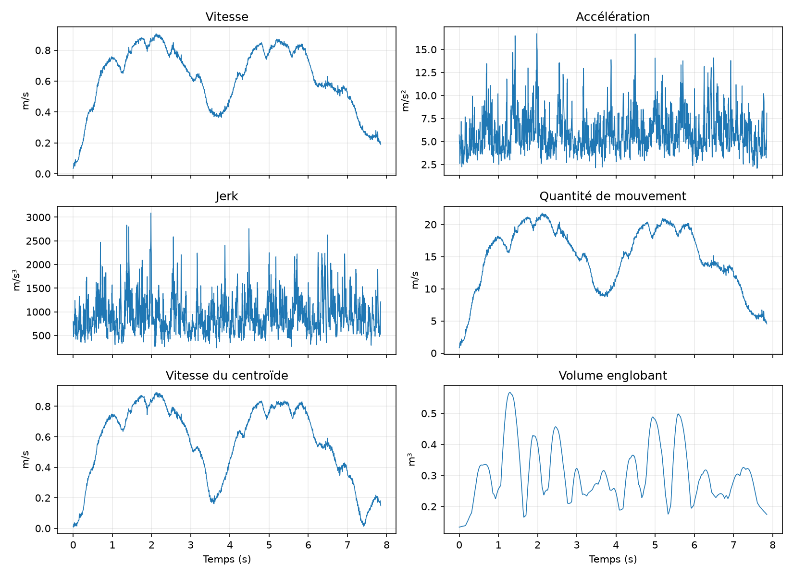
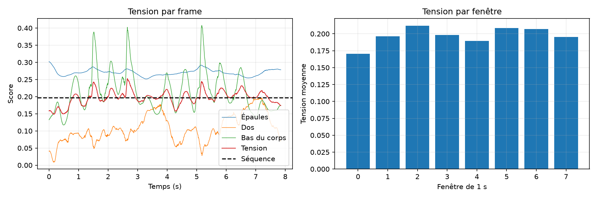
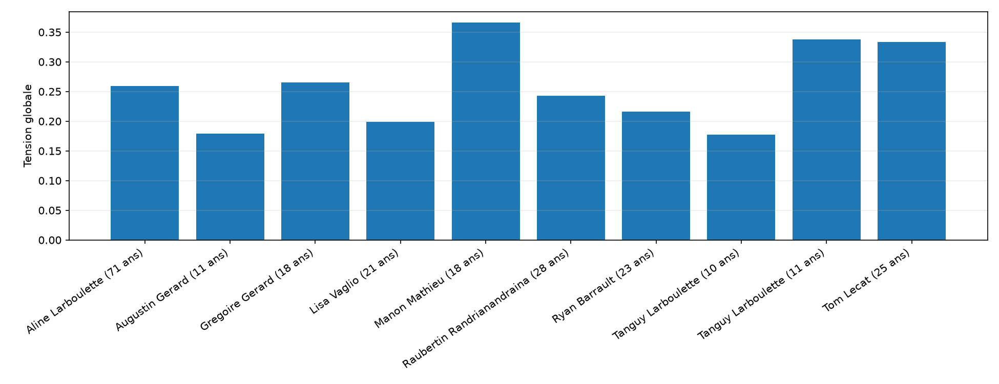
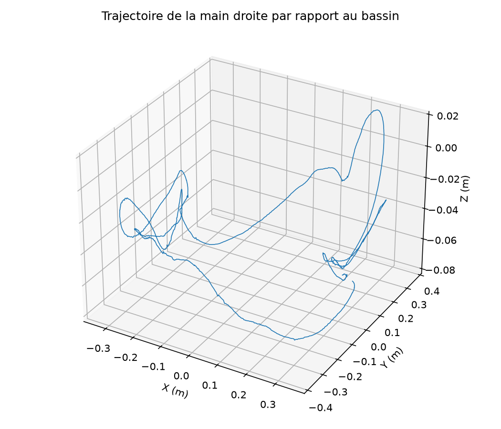

# TP02 - Motion Descriptors

Ce README c'est le rapport du TP.

## Installation et lancement

Bon, vu qu'il manquait certains packages pour faire fonctionner le projet, j'ai utilisé `uv` pour gérer Python et les dépendances automatiquement.

Si vous n'avez pas `uv`, vous pouvez l'installer avec :

**Linux :**

```bash
curl -LsSf https://astral.sh/uv/install.sh | sh
```

**macOS (Homebrew) :**

```bash
brew install uv
```

Ensuite, à la racine du projet :

```bash
uv sync
```

Ça crée automatiquement un environnement Python `.venv` et installe toutes les dépendances définies dans le `pyproject.toml`.

Pour télécharger les TSV et générer le rapport avec les graphiques :

```bash
uv run python src/tsv_scraper.py
uv run python src/report.py
```

Les TSV sont téléchargés dans `assets/tsv/` et les graphiques sont générés dans `assets/plots/`.

Pour lancer l'animation :

```bash
uv run python src/main.py
```

Il est aussi possible d'activer directement l'environnement virtuel créé par `uv` :

```bash
source .venv/bin/activate
```

Et ensuite d'exécuter les scripts normalement avec `python`, sans passer par `uv run`.

## Données et descripteurs

`TsvParser` lit pour chaque frame la position et l'orientation de chaque articulation. Les positions, exprimées en millimètres dans les TSV, sont converties en mètres. La fréquence est lue dans chaque fichier, elle vaut 200 Hz pour vos fichiers.

Les descripteurs low-level sont la vitesse, l'accélération et le jerk. On derive simplement à la suite pour les obtenir.

Les descripteurs high-level sont :

- la quantité de mouvement
- la vitesse du centroïde
- le volume de la bounding box

## Tension

Pour la tension, j'ai essayé de l'estimer avec trois critères, mais je ne suis pas sûr que les résultats représentent vraiment la tension.

- **Élévation des épaules** : je compare la hauteur moyenne des épaules à celle de la nuque, en prenant en compte la longueur du torse pour éviter les différences par rapport à la taille des sujets.
- **Courbure du dos** : je calcule l'angle entre le bas et le haut du dos pour estimer à quel point le sujet est courbé.
- **Bas du corps** : je regarde la flexion des genoux et la position des chevilles pour essayer de détecter certaines postures, notamment quand le sujet se met sur la pointe des pieds.

Je combine ensuite les trois critères avec un poids égal pour chacun. Les valeurs sont normalisées avec des seuils fixes pour pouvoir comparer les différents sujets.

Le problème reste que ces critères ne correspondent pas forcément à une véritable tension musculaire. Par exemple, quelqu'un peut être courbé ou avoir les genoux fléchis sans être particulièrement tendu. Ça donne donc plutôt une estimation de la tension à partir de la posture, avec pas mal de limites.

## Résultats

Les statistiques suivantes correspondent à la séquence représentative d'Aline Larboulette en marche normale.

| Descripteur | Moyenne | Minimum | Maximum | Médiane |
| --- | ---: | ---: | ---: | ---: |
| Vitesse (m/s) | 0.621 | 0.0345 | 0.907 | 0.657 |
| Accélération (m/s²) | 6.00 | 2.07 | 16.72 | 5.50 |
| Jerk (m/s³) | 947 | 240 | 3089 | 855 |
| Quantité de mouvement (m/s) | 14.91 | 0.828 | 21.78 | 15.78 |
| Vitesse du centroïde (m/s) | 0.565 | 0.00772 | 0.892 | 0.634 |
| Volume englobant (m³) | 0.303 | 0.134 | 0.568 | 0.286 |



La tension est calculée pour chaque frame, moyennée par fenêtres d'une seconde, puis moyennée sur la séquence complète. Les valeurs globales de chaque séquence servent à comparer les sujets.

| Granularité | Valeurs | Moyenne | Minimum | Maximum | Médiane |
| --- | ---: | ---: | ---: | ---: | ---: |
| Frame | 1571 | 0.189 | 0.146 | 0.232 | 0.187 |
| Fenêtre de 1 s | 8 | 0.190 | 0.168 | 0.210 | 0.184 |
| Séquence complète | 1 | 0.189 | 0.189 | 0.189 | 0.189 |






