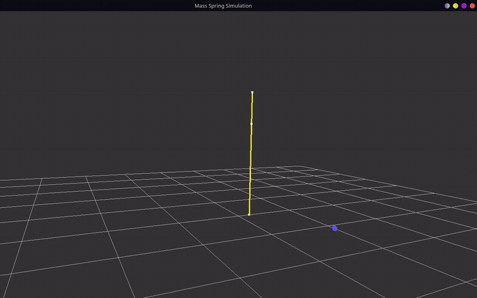

# Système masse-ressort

## A. Comment fixer les particules ?

Une particule est fixée en mettant sa masse à 0.

```cpp
if (node->mass <= 0.f)
    continue;
```

Ou alors on met une masse très haute, comme par exemple la taille max d'un uint.

## B. Dans quelles unités exprime-t-on la masse des particules et la longueur au repos des ressorts ?

Masse des particules : kilogrammes (kg)
Longueur au repos des ressorts : mètres (m)

## C. Quelles forces s'appliquent à chaque particule ?

Une force élastique : Fs = k * (longueur - longueurRepos) et une force d'amortissement basée sur la vitesse des deux particules.

Les deux particules reliées par un ressort reçoivent des forces + et - :

```cpp
n1->force += force;
n2->force -= force;
```

## D. Comment calculer la longueur au repos de chaque ressort ?

```cpp
restLength = (p1->position - p0->position).norm();
```

## Démo


